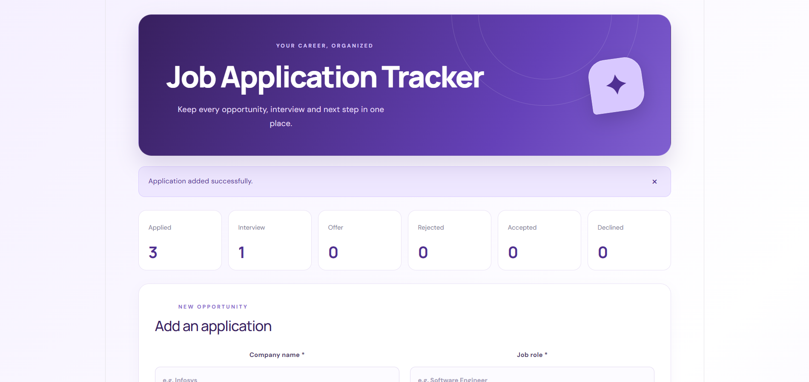
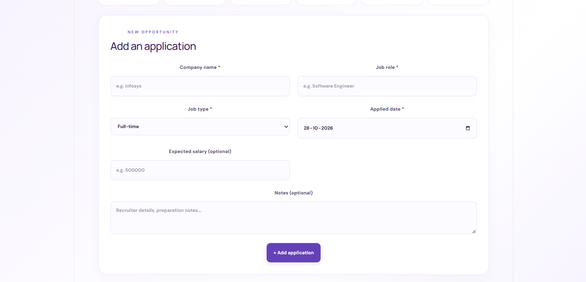
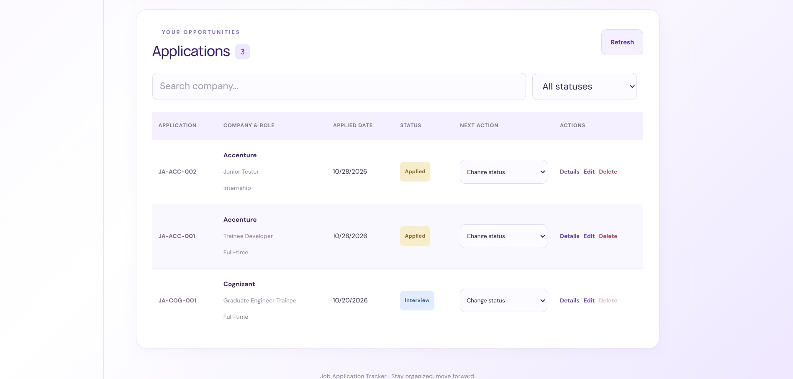

# Job Application Tracker

## Overview
A MERN Stack web application for recording job applications and tracking recruitment progress. Data is stored in MongoDB Atlas.

## Application Screenshots

### Dashboard – Overview

### Dashboard – Applications

### Dashboard – Application Details

## Features
- Add, view, edit and delete job applications.
- Automatically generate application IDs.
- Track application statuses and status history.
- Calculate follow-up dates and display overdue badges.
- Prevent duplicate active applications.
- Search by company and filter by status.
- Validate applied dates and enforce status and deletion rules.

## Technologies
- MongoDB Atlas
- Express.js
- React.js
- Node.js
- Mongoose

## Project Structure
- `frontend/` — React user interface
- `backend/` — Express API and database integration

## Setup
1. Install Node.js and npm.
2. Clone this repository.
3. Run `npm install` inside both the frontend and backend folders.
4. Create `backend/.env` using the environment variable names required by the backend. Set your MongoDB Atlas connection string.
5. Start the backend using `npm start` inside the backend folder.
6. Start the frontend using the script specified in its `package.json`.

## API Endpoints
| Method | Endpoint | Purpose |
|---|---|---|
| GET | `/api/health` | Check backend |
| GET | `/api/applications` | List and filter applications |
| GET | `/api/applications/:id` | Get one application |
| POST | `/api/applications` | Add application |
| PUT | `/api/applications/:id` | Edit application |
| PATCH | `/api/applications/:id/status` | Change status |
| DELETE | `/api/applications/:id` | Delete application |

## Security
Never upload real database credentials. Configure your own environment variables before running the application.

## Author
Student Project